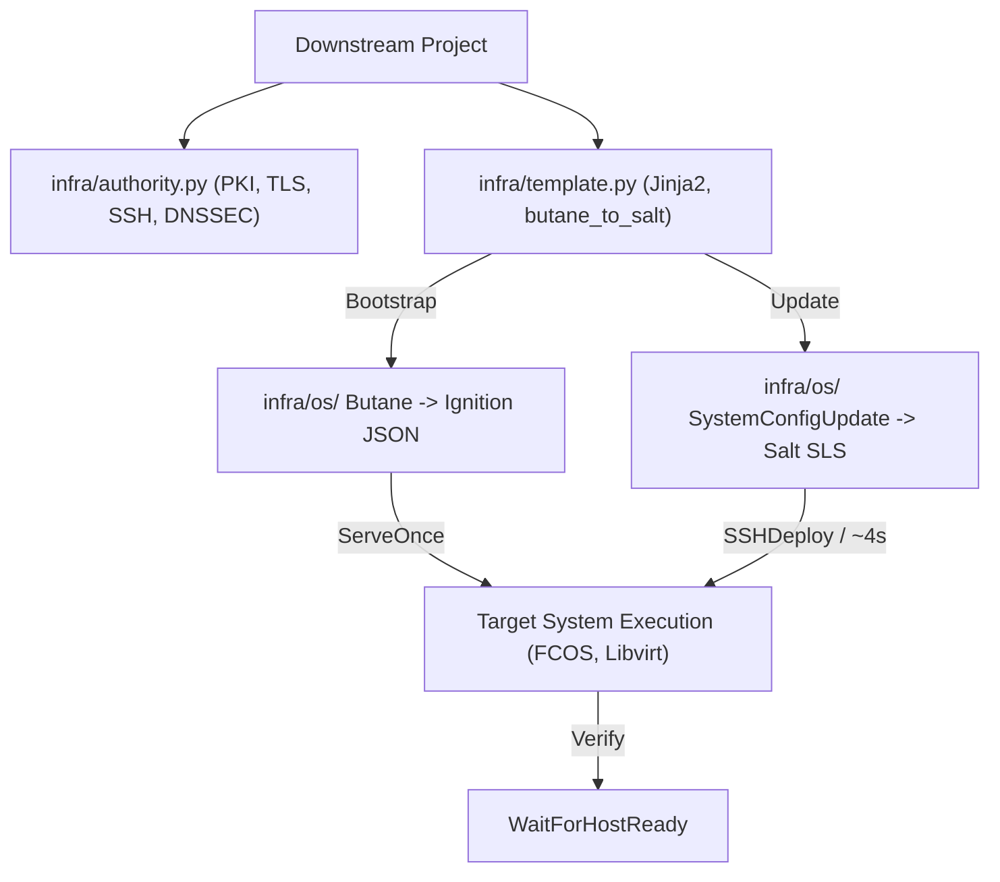

# Repository Guidelines

## Project Overview & Repository Context

`infra-shared` (the `infra` module) is a reusable Python library and toolset providing foundational infrastructure-as-code (IaC) primitives, CoreOS bootstrapping, Butane-to-SaltStack translation, and public-key infrastructure (PKI) for software-defined GitOps projects.

**Submodule Context**: `infra` is a Git submodule of a main monorepo per default, except when tested and developed independently. Tooling and paths must accommodate both standalone execution (`make test-all` directly in `infra`) and parent monorepo execution (where `infra` is mounted at `infra/`).

It is consumed by downstream projects as a Git submodule or standalone package to provide:
- **PKI & Trust Management**: X.509 TLS certificate authorities, client certificates, DNSSEC key pairs, and SSH authorized keys (`authority.py`).
- **CoreOS Orchestration**: Transpilation of Jinja2-templated Butane configurations into Ignition JSON and SaltStack state files (`os/`, `template.py`).
- **Remote Execution & Updates**: SSH deployment primitives (`SSHPut`, `SSHDeploy`, `SSHExecute`), dynamic host readiness polling (`WaitForHostReady`), and fast in-place system updates via SaltStack (`SystemConfigUpdate`).
- **Utility & Flashing Tooling**: Bootstrapping scripts, image flashing to removable media identified by hardware serial numbers, and one-shot HTTPS configuration servers (`tools.py`, `scripts/`).
---

## Architecture & Data Flow



---

## Key Directories

- `authority.py` - PKI framework (CA factories, TLS certs, SSH keys, DNSSEC)
- `template.py` - Jinja2 engine, path traversal validation, butane_to_salt compiler
- `tools.py` - Remote SSH deployment (SSHPut, SSHDeploy, SSHExecute), ServeOnce
- `os/` - Fedora CoreOS orchestration and update services
  - `__init__.py` - ButaneTranspiler, SystemConfigUpdate, LibvirtIgniteFcos
  - `system.bu`, `podman.bu`, `compose.bu`, `nspawn.bu` - Core system & container specs
  - `unbound.bu`, `knot.bu` - DNS resolver and DNS server configs
- `scripts/` - Operational scripts
  - `provision_requirements.sh` - Dependency installer for Arch, Debian, containers
  - `write_removable.py` - Image flasher by hardware serial
  - `serve_once.py`, `port_forward.py`, `create_skeleton.sh` - Deployment utilities
- `tests/` - Pytest test suite using Pulumi Automation API
  - `conftest.py`, `utils.py` - Test fixtures and inline Pulumi test helpers
- `examples/` - Reference implementations (`safe/`, `modules/postgresql/`, `skeleton/`)
- `container/` & `Containerfile/` - Quadlets and container recipes
- `docs/` - Architecture and developer manuals
---

## Development & Lifecycle Workflow

> **MANDATORY**: For all environment setup, building, linting, testing, and Pulumi stack commands, agents MUST read [`docs/development.md`](docs/development.md). Do not duplicate or improvise lifecycle commands.

### Quick Reference

- **Prerequisites & Setup**: `make provision-local` (installs system binaries) and `make buildenv` (creates Python 3.13+ `.venv` with `uv`).
- **Testing**: `make pytest` (run pytest suite), `make pytest args="tests/test_<name>.py"`, `make test-all` (builds online docs and runs full test suite).
- **Code Quality**: `uv run ruff check .`, `uv run ruff format .` (line length: 95), `uv run pyright`.
- **Documentation**: `make docs` (local build), `make docs-serve` (live reload on port 8000), `make docs-online-build`.
- **Stack Lifecycle**: `make sim-create`, `make sim-up`, `make sim-clean` (local simulation); `make prod-create`, `make prod-up` (production).
---

## Code Conventions & Common Patterns

### Architecture & Design
- **Single-Responsibility Files**: Keep files below 800 lines of code. Split complex features into modular subpackages.
- **Component Resources**: Extend `pulumi.ComponentResource` for composite infrastructure abstractions. Pass `ResourceOptions(parent=self)` to all child resources.
- **Dynamic Providers**: Extend `pulumi.dynamic.Resource` and `pulumi.dynamic.ResourceProvider` when interacting with systems lacking official Pulumi providers (e.g., `WaitForHostReady`).
- **Diagrams in Markdown**: Use **Mermaid** (` ```mermaid `) as the diagram language for Markdown documentation (flows, sequences, architectures); avoid ASCII art.
### Pulumi Asynchronous Patterns
- **No Synchronous Output Resolution**: Never use Pulumi `Output[T]` objects in boolean checks, string concatenations, or dictionary keys directly.
  ```python
  # INCORRECT
  cert_dict = {cert.common_name: cert.pem}

  # CORRECT
  cert_dict = Output.all(cert.common_name, cert.pem).apply(
      lambda args: {args[0]: args[1]}
  )
  ```
- **Masking Secrets**: Wrap sensitive strings with `Output.secret(...)` and ensure command outputs containing keys or passwords specify `additional_secret_outputs=["stdout"]`.

### Templating & Path Security
- **Directory Traversal Protection**: Always resolve user- or config-provided paths using `infra.template.join_paths(base_path, relative_path)`. This function raises an exception if the resulting path escapes `base_path`.
- **Empty YAML Safety**: Rendered Jinja templates that produce empty or whitespace-only output evaluate to `None` in `yaml.safe_load`. Always handle empty results safely: `yaml_loads(rendered) or {}`.

### Remote Execution Patterns
- **Simulation Mode**: Primitives in `infra.tools` (`SSHPut`, `SSHDeploy`, `SSHExecute`) support a `simulate: bool` argument. When `True`, files and commands write to local directories (e.g., `build/tmp/sim`) instead of executing network calls, allowing fast, offline unit testing.
- **Retry Resilience**: Dynamic polling resources like `WaitForHostReady` must implement explicit retry limits, timeouts, and exponential backoff.

---

## Important Files

| File | Purpose |
|:---|:---|
| `authority.py` | Core PKI framework; CA factories, TLS cert generation, DNSSEC KSK/ZSK pairs, SSH keys. |
| `template.py` | Jinja2 templating engine, custom filters, and `butane_to_salt` translation compiler. |
| `tools.py` | SSH automation primitives (`SSHPut`, `SSHDeploy`, `SSHExecute`), `WaitForHostReady`, `ServeOnce`. |
| `os/__init__.py` | CoreOS transpilation (`ButaneTranspiler`), image fetching, and `SystemConfigUpdate`. |
| `pyproject.toml` | Package build configuration (`setuptools_scm`), dependency declarations, Ruff/Pyright settings. |
| `Makefile` | Central task runner for testing, documentation, environment building, and cleanup. |
| `scripts/provision_requirements.sh` | Automated host dependency installer supporting Arch, Manjaro, Debian/Ubuntu, and containers. |
| `scripts/create_skeleton.sh` | Project scaffolding tool that creates a downstream infrastructure repository linked to `infra`. |
| `tests/conftest.py` | Pytest fixtures providing isolated Pulumi stacks and in-memory Paramiko SSH mock servers. |

---

## Runtime & Tooling Preferences

- **Python Runtime**: Python `>=3.13`.
- **Package Manager**: **`uv`** is strictly required for virtualenv creation and package management (`uv sync --all-extras`, `uv lock`). Never use `pip` directly.
- **Infrastructure Engine**: `pulumi` CLI (pinned `>=3.273.0, <4.0.0`).
- **Container Engine**: `podman` (default overridable with `CONTAINER_CMD=docker`).
- **System Binaries Required**:
  - `butane`: Transpiling Butane YAML to Ignition JSON.
  - `coreos-installer`: Embedding Ignition configurations into raw disk images.
  - `openssl`: Certificate inspection, key generation, and PKCS12 parsing.
  - `age`: Encrypted credentials and secret management.
  - `knot` / `knsupdate`: DNS server administration and dynamic zone updates.
  - `vault`: Optional backend for HashiCorp Vault CA integration.

---

## Testing & QA

### Testing Architecture
The `tests/` directory uses **pytest** with the **Pulumi Automation API** (`pulumi.automation.Stack`) to run reproducible integration tests against isolated local file-backed state workspaces.

### Core Fixtures (`tests/conftest.py`)
- **`pulumi_stack`**: Initializes a temporary Pulumi stack (`sim`), configures file-backed state under `state/pulumi`, yields the stack to the test, and guarantees teardown via `stack.destroy()` in a `finally` block.
- **`pulumi_project_dir`**: Dynamically creates a temporary Git repository, executes `scripts/create_skeleton.sh`, and links the project's virtualenv to the active test runner.
- **`robust_ssh_server`**: In-process multi-threaded Paramiko SSH server running on `127.0.0.1` capable of simulating server latency, connection loss, and authentication behavior.

### Writing New Tests
1. **Use `utils.add_pulumi_program`**: Define minimal Pulumi test programs inline:
   ```python
   from tests.utils import add_pulumi_program

   add_pulumi_program(
       pulumi_project_dir,
       """
   import pulumi
   from infra.authority import CACertFactory
   ca = CACertFactory("test_ca")
   pulumi.export("ca_cert", ca.root_cert_pem)
   """,
   )
   ```
2. **Execute and Assert**:
   ```python
   up_result = pulumi_stack.up(**pulumi_up_args)
   assert up_result.summary.result == "succeeded"
   assert "ca_cert" in up_result.outputs
   ```
3. **Prefer Simulation for File/SSH Tests**: Set `simulate=True` when validating `SSHPut` or `SSHDeploy` to inspect output files under `build/tmp/sim/` without spawning network sockets.

### Test-Driven Development (TDD) & Research Notes

See [`docs/development.md`](docs/development.md) for full TDD guidelines, pytest plugin isolation rationale (`-p no:pylama`), and simulation conventions (`SSHPut`, `SSHDeploy`, `SSHGet`, `LocalSaltCall`).
