# Project Skeleton Template

This directory contains baseline template files used by [`infra/scripts/create_skeleton.sh`](../../scripts/create_skeleton.sh) to bootstrap a new GitOps-driven infrastructure project utilizing the shared `infra` library.

---

## Skeleton Files & Structure

| File | Purpose |
|:---|:---|
| [`Makefile`](Makefile) | Task automation for environment creation (`buildenv`), stack management (`sim` and `prod`), testing (`pytest`), and documentation (`docs`). |
| [`pyproject.toml`](pyproject.toml) | Python project configuration specifying `>=3.13` runtime, core dependencies (Pulumi, SaltStack, Jinja2, Paramiko, Cryptography), Ruff/Pyright settings, and optional dependencies. |

When initialized via `create_skeleton.sh`, the following project structure is generated:

```mermaid
flowchart TD
    Root["&lt;project_name&gt;/"] --> Main["__main__.py (Pulumi entry point)"]
    Root --> Pulumi["Pulumi.yaml (Virtualenv configuration)"]
    Root --> Make["Makefile (Build & stack targets)"]
    Root --> Py["pyproject.toml (Dependencies & tools)"]
    Root --> Conf["config-template.yaml (Stack defaults)"]
    Root --> Keys["authorized_keys (SSH access)"]
    Root --> Mkdocs["mkdocs.yml (Documentation site)"]
    Root --> Target["target/ (Node & workload modules)"]
    Root --> Docs["docs/ (Markdown documentation)"]
    Root --> State["state/ (Encrypted Pulumi state)"]
    Root --> Infra["infra/ (Shared infrastructure submodule)"]
```



---

## Creating a New Project

Use `create_skeleton.sh` from the shared infrastructure repository:

```bash
# Generate a new project in ../my-infra
./infra/scripts/create_skeleton.sh --project-dir ../my-infra --name-library infra --yes
```

---

## Getting Started with a Skeleton Project

### 1. Initialize Build Environment
```bash
# Install system packages and binaries (pulumi, podman, butane, age, openssl)
make provision-local

# Create virtualenv and synchronize locked dependencies with uv
make buildenv
```

### 2. Local Simulation (`sim`)
```bash
# Initialize local simulation stack
make sim-create

# Preview changes against local Libvirt/QEMU
make sim-preview

# Deploy to simulation
make sim-up

# Clean up simulation stack
make sim-clean
```

### 3. Production Deployment (`prod`)
```bash
# Add administrative public keys to authorized_keys
echo "ssh-ed25519 AAAA..." >> authorized_keys

# Generate encrypted passphrase with age
make prod_passphrase.age

# Initialize and deploy production stack
make prod-create
make prod-preview
make prod-up
```
